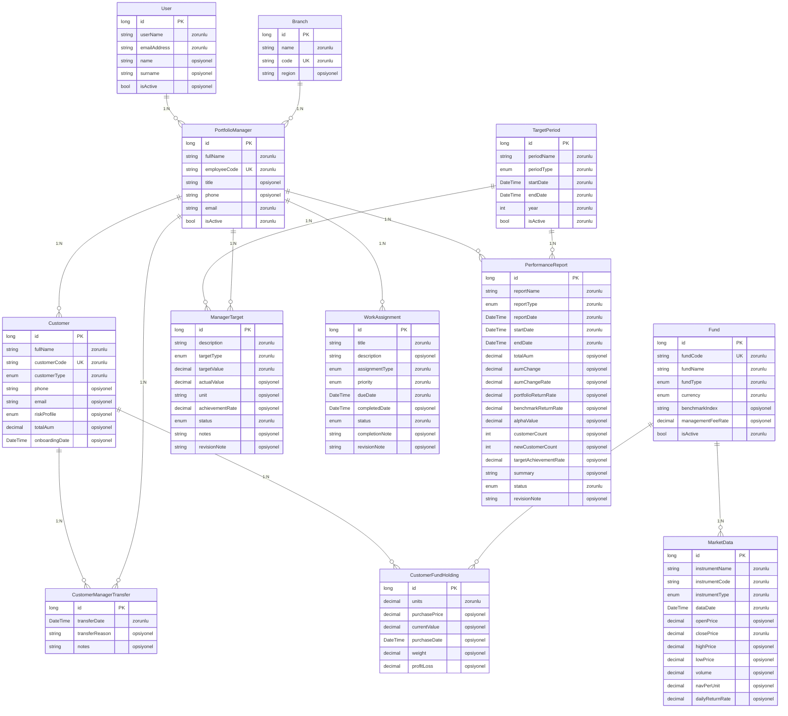
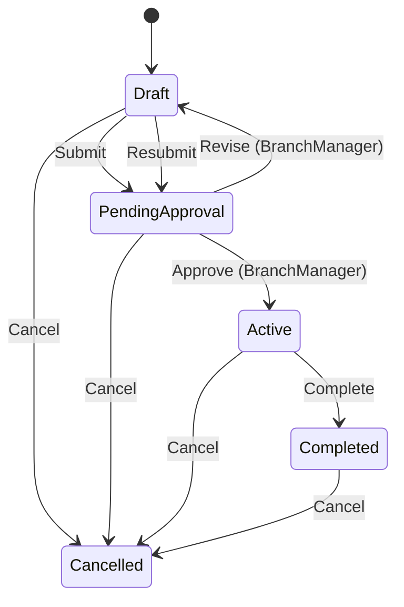
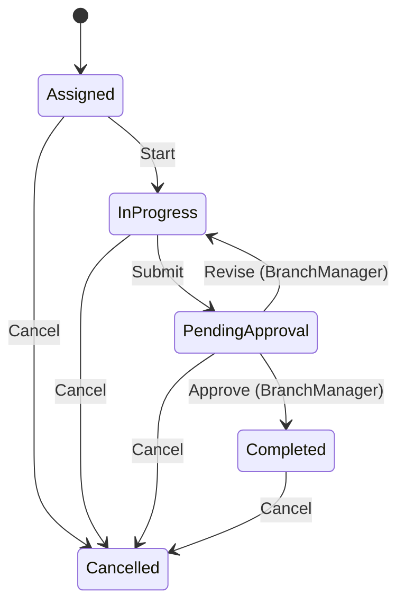
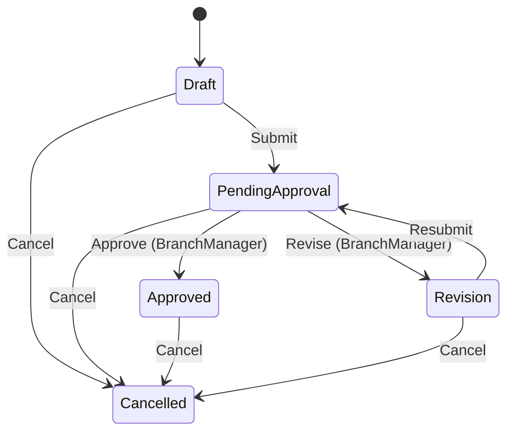
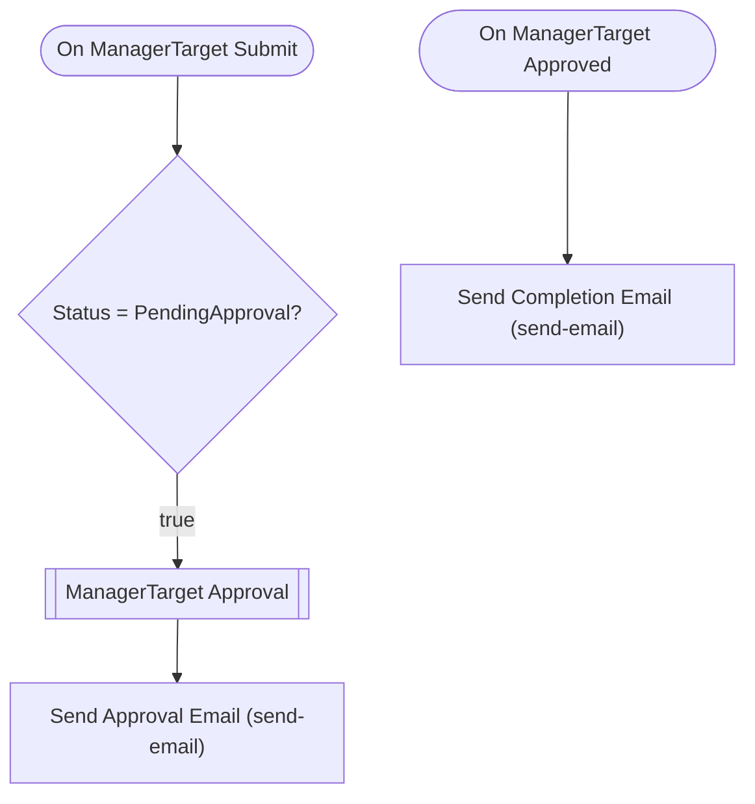
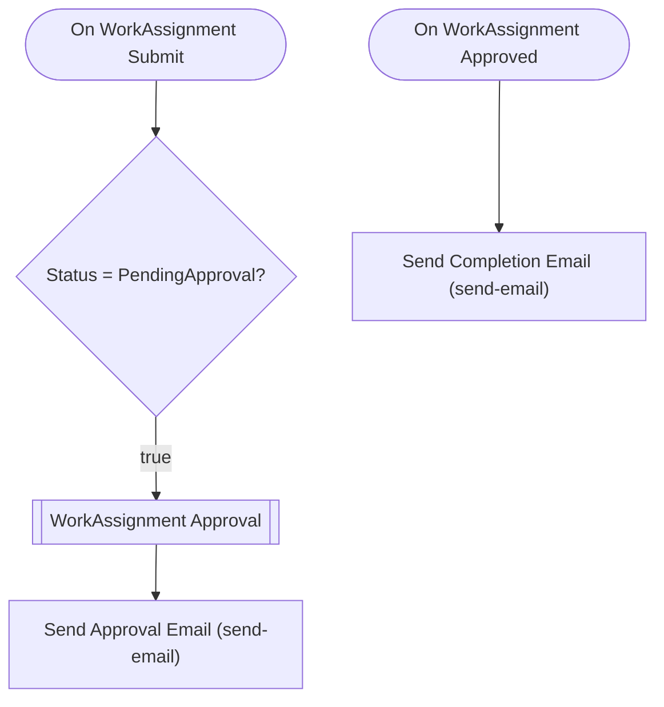
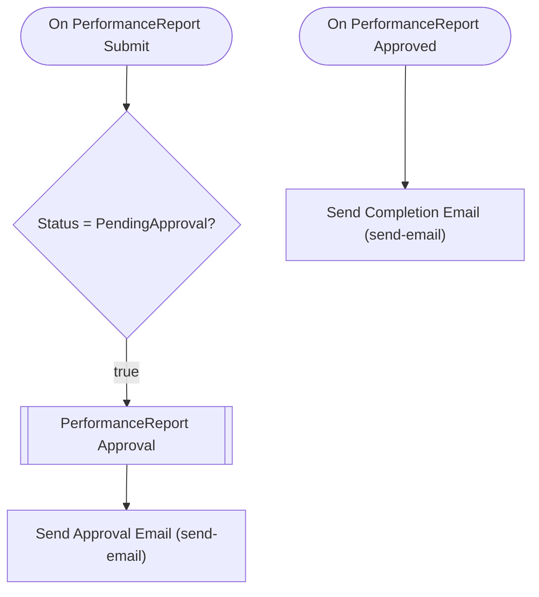

# portföy-yönetim-sistemi — Talep Analizi

> Bu belge Archipid talep olgunlaştırma (discovery) akışıyla üretildi.

## Orijinal Talep

portföy yöneticilerinin günlük, haftalık,aylık hedeflerini takip edebileceği yönettiği portföydeki fonların müşteri bazlı kırılımlarını görebileceği günlük piyasa verilerini takip edebileceği, performans raporlarını çekebileceği bir uygulama istiyorum. şube müdürlerinin altındaki portföy yöneticilerine iş atayabileceği onay adımları olan bir yapı olacak

## Özet

Portföy Yönetim Sistemi, bankalardaki portföy yöneticilerinin müşterilerini, yönettikleri fonları ve kişisel hedeflerini tek ekrandan takip etmesini sağlar. Şube müdürleri ve bölge direktörleri, ekiplerindeki yöneticilere iş atayabilir; hedefleri, performans raporlarını ve iş tamamlamalarını onaylayabilir.

Şube müdürü portföy yöneticisine iş atar → yönetici işi başlatır, tamamlayıp onaya sunar → şube müdürü onaylar ya da revize ister. Hedef sürecinde: yönetici veya direktör hedef oluşturur → şube müdürü onaylarsa hedef aktife geçer, gerçekleşen değerler yönetici tarafından manuel girilir. Performans raporu sürecinde: yönetici raporu oluşturup onaya gönderir → şube müdürü onaylar; revize isterse rapor yöneticiye geri döner. Müşteri başka bir yöneticiye devredilmek istendiğinde devir kaydı oluşturulur; geçmiş yönetici ve devir tarihi saklanır.

## Kapsam

- (belirtilmedi)

## Kapsam Dışı

- (belirtilmedi)

## Açık Noktalar

- (belirtilmedi)

## Eksiklikler

- (belirtilmedi)

## Öneriler

- (belirtilmedi)

## Veri Modeli

### User — Kullanıcı (Sistem)

| Alan | Tip | Zorunlu | Uzunluk |
|---|---|---|---|
| `id` | long | Evet | — |
| `userName` | string | Evet | 64 |
| `emailAddress` | string | Evet | 256 |
| `name` | string | Hayır | 128 |
| `surname` | string | Hayır | 128 |
| `isActive` | bool | Hayır | — |

**Neye bağlı:** PortfolioManager (1:N, bu tablo "bir" tarafı)

### Branch — Şube

| Alan | Tip | Zorunlu | Uzunluk |
|---|---|---|---|
| `id` | long | Evet | — |
| `name` | string | Evet | 200 |
| `code` | string | Evet | 20 |
| `region` | string | Hayır | 100 |

**Neye bağlı:** PortfolioManager (1:N, bu tablo "bir" tarafı)

### PortfolioManager — Portföy Yöneticisi

| Alan | Tip | Zorunlu | Uzunluk |
|---|---|---|---|
| `id` | long | Evet | — |
| `fullName` | string | Evet | 200 |
| `employeeCode` | string | Evet | 50 |
| `title` | string | Hayır | 100 |
| `phone` | string | Hayır | 20 |
| `email` | string | Evet | 256 |
| `isActive` | bool | Evet | — |

**Neye bağlı:** User (1:N, bu tablo "çok" tarafı) · Branch (1:N, bu tablo "çok" tarafı) · Customer (1:N, bu tablo "bir" tarafı) · CustomerManagerTransfer (1:N, bu tablo "bir" tarafı) · ManagerTarget (1:N, bu tablo "bir" tarafı) · WorkAssignment (1:N, bu tablo "bir" tarafı) · PerformanceReport (1:N, bu tablo "bir" tarafı)

### Customer — Müşteri

| Alan | Tip | Zorunlu | Uzunluk |
|---|---|---|---|
| `id` | long | Evet | — |
| `fullName` | string | Evet | 200 |
| `customerCode` | string | Evet | 50 |
| `customerType` | enum (Individual,Corporate) | Evet | — |
| `phone` | string | Hayır | 20 |
| `email` | string | Hayır | 256 |
| `riskProfile` | enum (Conservative,Balanced,Aggressive) | Hayır | — |
| `totalAum` | decimal | Hayır | — |
| `onboardingDate` | DateTime | Hayır | — |

**Neye bağlı:** PortfolioManager (1:N, bu tablo "çok" tarafı) · CustomerManagerTransfer (1:N, bu tablo "bir" tarafı) · CustomerFundHolding (1:N, bu tablo "bir" tarafı)

### CustomerManagerTransfer — Müşteri Devir Kaydı

| Alan | Tip | Zorunlu | Uzunluk |
|---|---|---|---|
| `id` | long | Evet | — |
| `transferDate` | DateTime | Evet | — |
| `transferReason` | string | Hayır | 500 |
| `notes` | string | Hayır | 1000 |

**Neye bağlı:** Customer (1:N, bu tablo "çok" tarafı) · PortfolioManager (1:N, bu tablo "çok" tarafı)

### Fund — Fon

| Alan | Tip | Zorunlu | Uzunluk |
|---|---|---|---|
| `id` | long | Evet | — |
| `fundCode` | string | Evet | 20 |
| `fundName` | string | Evet | 200 |
| `fundType` | enum (EquityFund,BondFund,MoneyMarket,MixedFund,IndexFund,HedgeFund) | Evet | — |
| `currency` | enum (TRY,USD,EUR) | Evet | — |
| `benchmarkIndex` | string | Hayır | 100 |
| `managementFeeRate` | decimal | Hayır | — |
| `isActive` | bool | Evet | — |

**Neye bağlı:** CustomerFundHolding (1:N, bu tablo "bir" tarafı) · MarketData (1:N, bu tablo "bir" tarafı)

### CustomerFundHolding — Müşteri Fon Pozisyonu

| Alan | Tip | Zorunlu | Uzunluk |
|---|---|---|---|
| `id` | long | Evet | — |
| `units` | decimal | Evet | — |
| `purchasePrice` | decimal | Hayır | — |
| `currentValue` | decimal | Hayır | — |
| `purchaseDate` | DateTime | Hayır | — |
| `weight` | decimal | Hayır | — |
| `profitLoss` | decimal | Hayır | — |

**Neye bağlı:** Customer (1:N, bu tablo "çok" tarafı) · Fund (1:N, bu tablo "çok" tarafı)

### MarketData — Piyasa Verisi

| Alan | Tip | Zorunlu | Uzunluk |
|---|---|---|---|
| `id` | long | Evet | — |
| `instrumentName` | string | Evet | 200 |
| `instrumentCode` | string | Evet | 50 |
| `instrumentType` | enum (Fund,StockIndex,CurrencyPair,CommodityIndex,InterestRate) | Evet | — |
| `dataDate` | DateTime | Evet | — |
| `openPrice` | decimal | Hayır | — |
| `closePrice` | decimal | Evet | — |
| `highPrice` | decimal | Hayır | — |
| `lowPrice` | decimal | Hayır | — |
| `volume` | decimal | Hayır | — |
| `navPerUnit` | decimal | Hayır | — |
| `dailyReturnRate` | decimal | Hayır | — |

**Neye bağlı:** Fund (1:N, bu tablo "çok" tarafı)

### TargetPeriod — Hedef Dönemi

| Alan | Tip | Zorunlu | Uzunluk |
|---|---|---|---|
| `id` | long | Evet | — |
| `periodName` | string | Evet | 100 |
| `periodType` | enum (Daily,Weekly,Monthly) | Evet | — |
| `startDate` | DateTime | Evet | — |
| `endDate` | DateTime | Evet | — |
| `year` | int | Evet | — |
| `isActive` | bool | Evet | — |

**Neye bağlı:** ManagerTarget (1:N, bu tablo "bir" tarafı) · PerformanceReport (1:N, bu tablo "bir" tarafı)

### ManagerTarget — Portföy Yöneticisi Hedefi

| Alan | Tip | Zorunlu | Uzunluk |
|---|---|---|---|
| `id` | long | Evet | — |
| `description` | string | Evet | 500 |
| `targetType` | enum (AumGrowth,NewCustomer,RetentionRate,ReturnRate,TransactionCount,CustomTarget) | Evet | — |
| `targetValue` | decimal | Evet | — |
| `actualValue` | decimal | Hayır | — |
| `unit` | string | Hayır | 50 |
| `achievementRate` | decimal | Hayır | — |
| `status` | enum (Draft,PendingApproval,Active,Completed,Cancelled) | Evet | — |
| `notes` | string | Hayır | 1000 |
| `revisionNote` | string | Hayır | 1000 |

**Neye bağlı:** TargetPeriod (1:N, bu tablo "çok" tarafı) · PortfolioManager (1:N, bu tablo "çok" tarafı)

### WorkAssignment — İş Ataması

| Alan | Tip | Zorunlu | Uzunluk |
|---|---|---|---|
| `id` | long | Evet | — |
| `title` | string | Evet | 200 |
| `description` | string | Hayır | 2000 |
| `assignmentType` | enum (CustomerVisit,ReportPreparation,PortfolioReview,TrainingTask,ComplianceTask,CustomTask) | Evet | — |
| `priority` | enum (Low,Medium,High,Critical) | Evet | — |
| `dueDate` | DateTime | Evet | — |
| `completedDate` | DateTime | Hayır | — |
| `status` | enum (Assigned,InProgress,PendingApproval,Completed,Cancelled) | Evet | — |
| `completionNote` | string | Hayır | 2000 |
| `revisionNote` | string | Hayır | 1000 |

**Neye bağlı:** PortfolioManager (1:N, bu tablo "çok" tarafı)

### PerformanceReport — Performans Raporu

| Alan | Tip | Zorunlu | Uzunluk |
|---|---|---|---|
| `id` | long | Evet | — |
| `reportName` | string | Evet | 200 |
| `reportType` | enum (Daily,Weekly,Monthly,Quarterly,Annual) | Evet | — |
| `reportDate` | DateTime | Evet | — |
| `startDate` | DateTime | Evet | — |
| `endDate` | DateTime | Evet | — |
| `totalAum` | decimal | Hayır | — |
| `aumChange` | decimal | Hayır | — |
| `aumChangeRate` | decimal | Hayır | — |
| `portfolioReturnRate` | decimal | Hayır | — |
| `benchmarkReturnRate` | decimal | Hayır | — |
| `alphaValue` | decimal | Hayır | — |
| `customerCount` | int | Hayır | — |
| `newCustomerCount` | int | Hayır | — |
| `targetAchievementRate` | decimal | Hayır | — |
| `summary` | string | Hayır | 3000 |
| `status` | enum (Draft,PendingApproval,Approved,Revision,Cancelled) | Evet | — |
| `revisionNote` | string | Hayır | 1000 |

**Neye bağlı:** PortfolioManager (1:N, bu tablo "çok" tarafı) · TargetPeriod (1:N, bu tablo "çok" tarafı)

## İş Akışları

### Portföy Yöneticisi Hedefi — durum makinesi

**Onay adımları**

| # | Adım | Atanan | Aksiyonlar | Zorunlu alanlar |
|---|---|---|---|---|
| 1 | Şube Müdürü Onayı | Rol: `BranchManager` | Onayla (approve), Revize Et (revise) | `revisionNote` |

Reddedilirse kayıt **`Draft`** durumuna döner.

### İş Ataması — durum makinesi

**Onay adımları**

| # | Adım | Atanan | Aksiyonlar | Zorunlu alanlar |
|---|---|---|---|---|
| 1 | Şube Müdürü Onayı | Rol: `BranchManager` | Tamamlandı Onayla (approve), Revize Et (revise) | `revisionNote` |

Reddedilirse kayıt **`InProgress`** durumuna döner.

### Performans Raporu — durum makinesi

**Onay adımları**

| # | Adım | Atanan | Aksiyonlar | Zorunlu alanlar |
|---|---|---|---|---|
| 1 | Şube Müdürü Onayı | Rol: `BranchManager` | Onayla (approve), Revize Et (revise) | `revisionNote` |

Reddedilirse kayıt **`Revision`** durumuna döner.

### Akış: ManagerTarget Approval Flow

Auto-generated approval flow for ManagerTarget. Customize email templates and add conditions as needed.

### Akış: WorkAssignment Approval Flow

Auto-generated approval flow for WorkAssignment. Customize email templates and add conditions as needed.

### Akış: PerformanceReport Approval Flow

Auto-generated approval flow for PerformanceReport. Customize email templates and add conditions as needed.

## Elle Geliştirme Gerektirenler

Aşağıdaki maddeler senaryonun gereği ama üretilen koda yansımıyor — kod yazılması gerekir.

| Alan | İş | Neden | Geçici çözüm |
|---|---|---|---|
| entity | Gerçekleşen AUM ve getiri değerlerinin otomatik hesaplanması | currentValue, achievementRate, portfolioReturnRate gibi hesaplanan metrikler dış veri kaynaklarından (fiyat feed, portföy sistemi) gelmeli; platform formül/hesaplama motoru üretmiyor. | Bu alanlar manuel olarak portföy yöneticisi tarafından girilir veya varsa dış sistem entegrasyonuyla sonradan güncellenir. |
| flow | Müşteri bazlı portföy ağırlığı ve toplam AUM otomatik toplanması | CustomerFundHolding.currentValue toplamından Customer.totalAum hesaplanması cross-entity otomasyonu gerektirir; desteklenmiyor. | totalAum ve weight alanları manuel veya periyodik toplu güncelleme ile doldurulur. |
| flow | Günlük piyasa verisi otomatik çekimi | MarketData kayıtlarının borsadan/veri sağlayıcıdan otomatik alınması için harici API entegrasyonu gerekli; platform API bağlayıcı üretmiyor. | MarketData kayıtları manuel girilir veya geliştirici CSV import / API entegrasyon servisi ekler. |
| flow | Müşteri devri sonrası yeni yöneticiye otomatik atama | CustomerManagerTransfer kaydı oluştuğunda Customer.portfolioManagerId alanının otomatik güncellenmesi cross-entity otomasyon gerektirir; desteklenmiyor. | Devir kaydı oluşturulduktan sonra şube müdürü müşteri kaydındaki yönetici alanını manuel günceller. |
